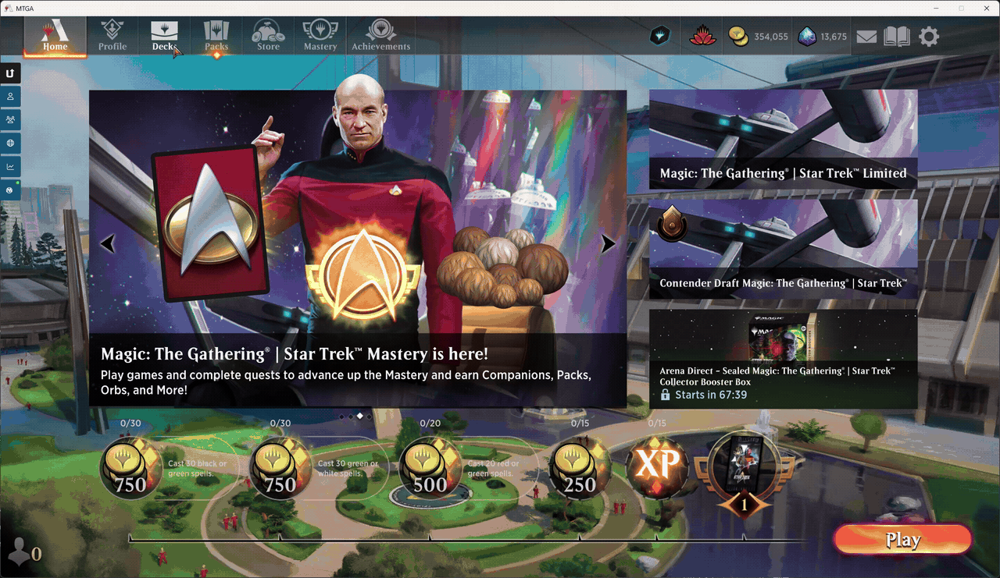

# Arena Deck Cleanup

**Bulk-delete decks fast. Skip Arena’s endless clicks.**

Platform: Windows

## Install

1. Download and unzip.
2. Close Arena. Double-click **Install.cmd**. Click **Yes** if asked.

## Fast bulk deletion

1. Open Arena → **Decks** → **Bulk delete**.
2. Check decks to **KEEP**, uncheck decks to **DELETE**, then **Review deletion → Delete**.

## Restore deleted decks

Backups never expire. Filter by name, date, or color.

Click the **archive gear**, select decks, then **Restore selected**.

## Uninstall

Close Arena. Double-click **Uninstall.cmd**.
Your decks and backups stay.

*Arena updates may require an app update.*

Known issue: Escape may also open Arena’s menu. Use **Close** instead.
